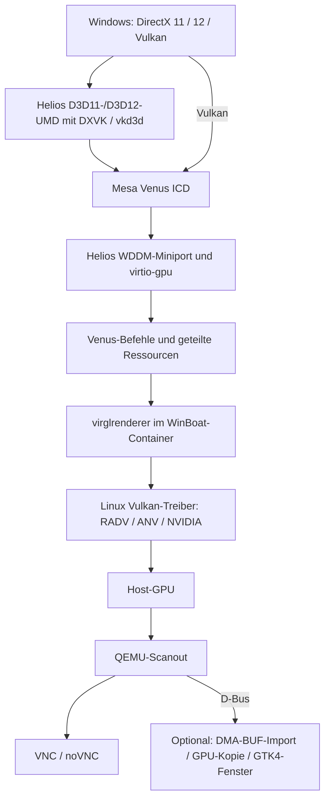
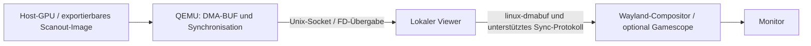

# Helios: Ziel für eine lokale GPU-Ausgabe

Der gemeinsame Docker-/Bash-Build stellt den bestehenden Helios-Stack bereit.
Ein erster optionaler GTK4-/OpenGL-Viewer ist jetzt implementiert; siehe
[lokaler Helios-Desktop](helios-local-display.md). Er nutzt DMA-BUF-Import mit
einer eigenen GPU-Präsentationstextur und konservativer Synchronisation.
Der Standard bleibt noVNC; Direct Scanout und explizite Wayland-Fences sind
weiterhin Ziel dieses Dokuments.

## Vorhandene Architektur

Windows bleibt eine vollständige VM. Der Miniport und die UMDs müssen die
erforderlichen WDDM-/DXGI-DDIs und deren Synchronisationsregeln implementieren.
Ein Venus ICD allein ersetzt diese Windows-Treiberschichten nicht. Die aktuelle
Miniport-Oberfläche ist WDDM 2.1; die Registrierung eines Adapters bestätigt
weder DirectX-Konformität noch fehlerfreie Shader- oder Spieleausführung.

Venus serialisiert Vulkan-Kommandos und übersetzt Objektidentitäten zwischen
Gast und Host. Shared Memory kann große Datenkopien vermeiden, beseitigt aber
nicht das Protokoll, die Validierung oder die Synchronisation. Gast-Zeiger sind
keine gültigen Host-Treiberzeiger. DXVK/vkd3d müssen weiterhin Vulkan-kompatible
Arbeit erzeugen; der Host kann Windows-Befehlszeiger nicht unverändert ausführen.

KVM-Memslots bilden Gastadressen auf bereitgestellten Speicher ab. `udmabuf`
exportiert geeigneten, dateibasierten Speicher als DMA-BUF; `ivshmem` stellt
geteilten Speicher über ein virtuelles PCI-Gerät bereit. Beides ist kein
allgemeiner direkter Zugriff auf beliebigen NVIDIA-/AMD-/Intel-VRAM. Der vorhandene
virtio-gpu/Venus-Blob-Pfad und memfd-Speicher bleiben die Ausgangsbasis; ein
zusätzlicher ivshmem-Transport braucht eine konkrete, nachgewiesene Notwendigkeit.

## Geplanter lokaler Ausgabepfad

Das gebaute QEMU bietet das D-Bus-Display-Backend bereits an (`-display help`).
Als Nächstes sind dessen DMA-BUF- und Synchronisationsschnittstellen mit einem
lokalen Viewer zu prüfen. Eine eigene Unix-Socket-Schnittstelle wäre erst bei
belegten Lücken nötig. Datei-Deskriptoren erfordern lokale Übergabe, etwa `SCM_RIGHTS`;
der bisherige TCP-/WebSocket-VNC-Kanal übernimmt diese Aufgabe nicht.

Notwendige Schnittstellen und Grenzen:

- **Ressourcen:** exportierbare Images sowie kompatible Formate, DRM-Modifier,
  Ebenen, Offsets und Strides zwischen Renderer, Viewer und Compositor aushandeln.
  Kopierpfade müssen erkennbar bleiben, wenn diese Voraussetzungen fehlen.
- **Synchronisation:** Renderabschluss vor dem Lesen sowie Freigabe durch den
  Compositor vor Wiederverwendung beachten. Sync-FDs bzw. Timeline-Synchronisation
  entsprechend den tatsächlich unterstützten Vulkan-/Wayland-Protokollen nutzen.
  Ein Buffer darf nicht beim nächsten Gast-Frame vorzeitig überschrieben werden.
- **Containergrenze:** einen lokalen Display-Endpunkt mit passenden
  Benutzerrechten bereitstellen. Der Viewer braucht keinen Docker-Socket.
  Der Hosttreiber bleibt Eigentümer der physischen GPU.
- **Anzeige:** Auflösung, Resize, Fullscreen, Cursor und Wiederverbindung
  behandeln. Multi-GPU-Import und NVIDIA-Modifier benötigen eigene Tests.
- **Bedienung:** Tastatur, Maus, relative Mausbewegung, Audio und Controller
  benötigen passende Transportpfade. DMA-BUF transportiert nur Bildressourcen.
- **Optionale Funktionen:** VRR benötigt Unterstützung von Gast-Present-Pacing,
  Viewer, Compositor, Displaymodus und Monitor. HDR verlangt durchgängige
  Farb-/Metadatenunterstützung einschließlich Gastanzeige und Host-Ausgabe.

Eine lokale DMA-BUF-Pipeline kann VNC-Readback, Kompression und zusätzliche
Bildkopien vermeiden. Das ist eine überprüfbare Optimierungshypothese. Sie
garantiert weder durchgehend Zero-Copy noch 144 Hz, VRR/HDR oder weniger als
1 ms Ende-zu-Ende-Latenz. Auch ein kopierfreier Pfad benötigt Scheduling und
Fences; Direct Scanout hängt zusätzlich vom Compositor und der Szene ab.

## Umsetzung und Abnahme

1. Aktuellen D3D11-/D3D12-/Vulkan- und Scanout-Pfad auf echter Hardware prüfen;
   Framezeiten und vorhandene Readback-/Kopierstellen messen.
2. QEMU-DMA-BUF-Export mit einem kleinen lokalen Viewer erproben. Zuerst einen
   vollständigen Frame samt Modifier und Synchronisation korrekt anzeigen.
3. Lebensdauer und Release-Fences bei hoher Last, Resize, Minimieren,
   Geräteverlust und Neustart testen; danach in WinBoat integrieren.
4. VNC als auswählbaren Rückfallpfad erhalten. Der Helios-Desktop nutzt aktuell
   bereits noVNC; einzelne RemoteApps verwenden weiterhin FreeRDP.
5. Bildkorrektheit und D3D-Konformität getrennt von Viewer-FPS und Eingabelatenz
   prüfen. Einen Leistungsgewinn mit identischer Szene und identischen
   Treibereinstellungen im Vergleich zum bisherigen Ausgabepfad messen.
6. Hohe Bildraten, VRR, HDR und Multi-GPU erst nach separaten Hardwaretests
   freigeben. Die verfügbaren Cloud-Build-Tests ersetzen diese Abnahme nicht.

Quellen und Build: [gemeinsame Quellen](../helios/README.md),
[lokaler Build](build-helios-local.md), [bestehende Integration](helios.md).
